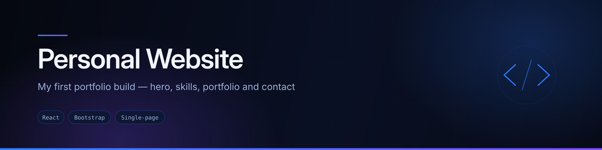
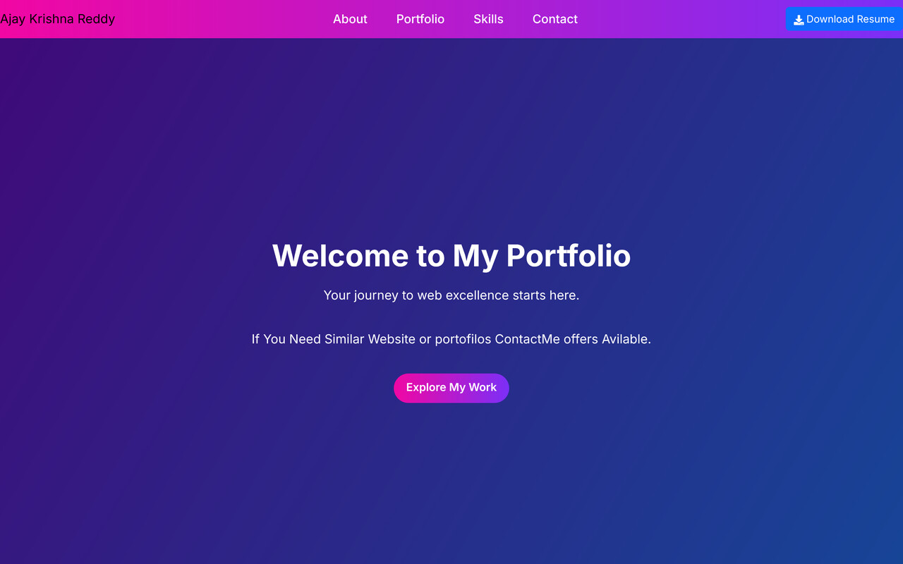

<div align="center">
  
</div>

<div align="center">


</div>

## Overview

My **first portfolio build** — a single scrolling page with a hero, about section, skills, portfolio grid, résumé download and contact details.

Kept as a starting point, not as current work. The portfolio I maintain is **[my_portfolio](https://github.com/AJAY2043/my_portfolio)**, which replaced this one with a theme system, data-driven content and scroll animation.

## Preview



<sub>Screenshot captured from a local production build of this repository.</sub>

## Features

- **Single-page layout** — Hero, About, Portfolio, Skills and Contact with anchored navigation
- **Résumé download** in the header
- **Portfolio grid**
- **Skills section**
- **Responsive** across breakpoints

## Tech stack

| Layer | Technology |
|---|---|
| Framework | React (Create React App) |
| Styling | Bootstrap, React Bootstrap, component CSS |
| Routing | None — single page with anchor navigation |

## Project structure

```
src/
├── Components/
│   ├── Navbar/, Hero/, About/, Skills/
│   ├── Portfolio/, Contact/, Footer/
│   └── Ajay_Assets/
└── App.js
```

## Running locally

```bash
git clone https://github.com/AJAY2043/personal-website.git
cd personal-website
npm install
npm start
```

```bash
npm run build     # production build into ./build
```

## A note on the dependency list

`package.json` here declares a much larger stack than the project uses. **None** of these are imported anywhere in `src/`:

`@mui/material` · `@emotion/react` · `@emotion/styled` · `firebase` · `@reduxjs/toolkit` · `axios` · `@fortawesome/*`

The project actually runs on React plus Bootstrap. I am leaving the record here rather than quietly pruning it, because it is a useful reminder: installing a library is not the same as using one, and a `package.json` is read by anyone assessing the project.

## Future improvements

- Prune the unused dependencies listed above
- Wire the contact form to a delivery service
- Add meta tags and an Open Graph image
- See `my_portfolio` for where this went next

## Author

**Ajay Krishna Reddy Bhavanam** — Melbourne, Australia
[LinkedIn](https://linkedin.com/in/ajay-krishna-reddy) · [GitHub](https://github.com/AJAY2043)
